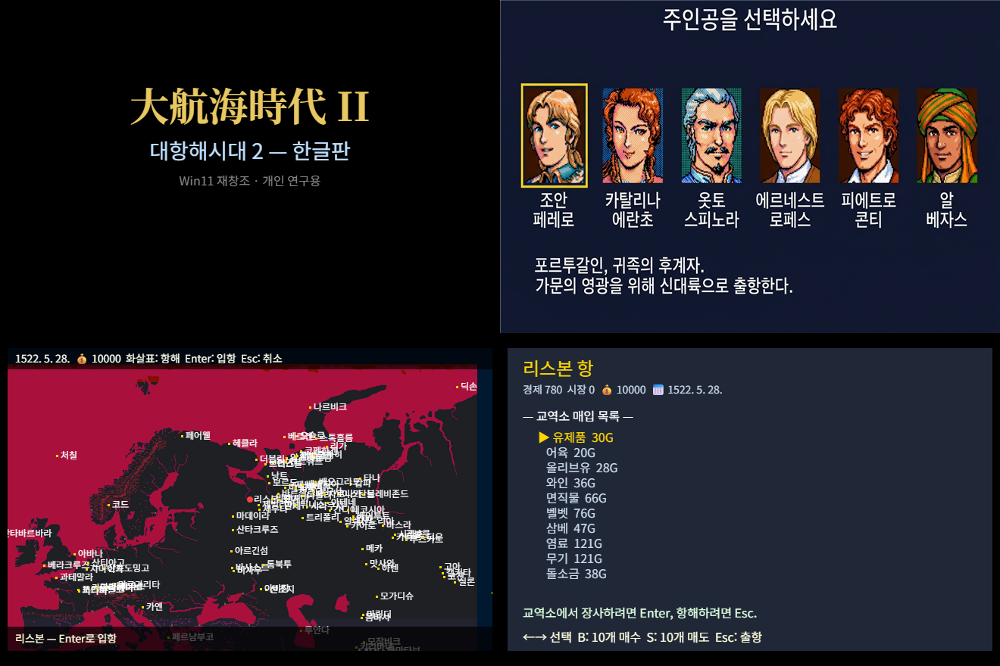

# ⛵ 대항해시대 2 한글판 — 1994년 리스본에서 Windows 11까지

> **"아버지의 뒤를 이어 바다로 나가거라… 근데 DOSBox 설정하다 지치진 말고."**
> 1994년 KOEI 한글 DOS판 원본 보존 + 바이너리 역공학 + Windows 11 네이티브 재창조 프로젝트



---

## 🚀 1. 일단 출항부터! (실행 방법)

이 저장소에는 **① Windows 11 네이티브 신형 함선(`app/`)** 과 **② 1994년 순정 DOS 범선(`run.bat`)** 두 척이 모두 정박해 있습니다. 취향대로 골라 타세요.

### ⚡ 방법 A: Windows 11 재창조판으로 출항 (추천)

DOS 에뮬레이터 없이 **Vite + TypeScript + Canvas + Electron**으로 돌아가는 현대판 실행기입니다. 추출된 한글 데이터(`app/public/db/`)와 그래픽이 이미 들어 있어서 클론 후 바로 뜹니다.

```powershell
cd app
.\uw2-launch.bat
```

> `uw2-launch.bat`이 최초 실행 시 `npm install` → Electron 런타임 다운로드 → `npx vite build` → 창 실행까지 자동으로 처리합니다. (수동으로 실행하려면 `npm install` 후 `npx vite build` → `.\uw2-launch.bat`)

- **브라우저 개발 모드로 띄우려면**: `cd app` 후 `npx vite` → `http://localhost:5180` 접속
- **조작법 (손가락만 있으면 됩니다)**:
  | 키 | 동작 | 비고 |
  | :---: | --- | --- |
  | `Enter` | 타이틀 넘기기 / 주인공 선택 / 근처 항구 입항 | 일단 연타하면 바다로 나갑니다 |
  | `←` `↑` `→` `↓` | 세계지도 항해 / 주인공·교역품 커서 이동 | |
  | `B` / `S` | 교역소에서 선택한 품목 **10개 매수(`B`) / 10개 매도(`S`)** | 시세 공식: $\lfloor \frac{(\text{rate}+50)\times\text{basePrice}}{100} \rfloor$ |
  | `Esc` | 항구에서 출항 (출항 시 항해 일수 +14일) | |
  | `F5` / `F9` | 현재 상태 즉시 세이브(`F5`) / 불러오기(`F9`) | `localStorage` 저장 |
  | **파일 드래그 & 드롭** | 창 위에 원본 `C HDD\KOUKAI2.DAT` 파일을 끌어다 놓기 | 원본 DOS 세이브 슬롯의 주인공 6인 한글 이름을 즉시 해독 |

---

### 💾 방법 B: 1994년 순정 DOS판으로 출항 (그 시절 감성 100%)

아무것도 설치할 필요 없습니다. 저장소 루트에서 배치 파일 하나만 치면 내장된 `DOSBox-0.74`가 `C HDD` 폴더를 `C:` 드라이브로 마운트하고 즉시 게임을 켭니다.

```powershell
# 반드시 저장소 루트 폴더에서 실행하세요!
.\run.bat
```

> [!TIP]
> **잠깐! 출항하려는데 갑자기 `금·목·수·화·토·일·월·천·지·인` 암호표를 물어본다면?**
> 당황해서 서랍 뒤지지 마세요. 30년 전 아래아한글 3.0 파일에서 완벽 복원해 둔 **[📜 대항해시대 2 암호 코드표](work/legacy-guides/대항해시대2-코드표.md)** 와 **[📖 고전 공략집](work/legacy-guides/대항해시대2-공략.md)** 이 준비되어 있습니다.

---

## 🧐 2. 대체 여기서 무슨 짓을 한 건가요? (배경 지식)

세상에는 훌륭한 영문판 리버스 엔지니어링 연구([JohanLi/uncharted-waters-2-research](https://github.com/JohanLi/uncharted-waters-2-research))가 있습니다. 그래서 처음엔 *"영문판 추출기에 한글판 파일만 넣으면 3분 만에 끝나겠지?"* 라고 생각했습니다.

**어림도 없었습니다.**

1. **한글 이름 확장 나비효과**: 영문판 항해사 이름은 9바이트인데, 한글판은 완성형(EUC-KR) 이름을 쓰려고 **13바이트×2**로 늘려 놓았습니다. 덕분에 레코드 크기가 `42B → 50B`로 불어났고, 뒤쪽 테이블 오프셋이 도미노처럼 밀렸습니다(`DATA1.015`는 무려 `+1,396B` 차이).
2. **바이트 덤프 방지용 제작자의 외침**: `ITEM.MES`를 124바이트 단위로 뜯어보니, 99번 더미 슬롯에 1994년 개발자가 숨겨 둔 완성형 한글 이스터에그가 튀어나왔습니다:
   > *"당신, 이제 데이터는 dump 하지 말아 줘요！"* (죄송합니다… 32년 뒤에 다 덤프했습니다.)
3. **타임캡슐 속 유물 총동원**:
   - **1995년 한국산 C 세이브 에디터(`C HDD/HORIEDIT.C`, `HORIEDIT.H`)**: 90년대 선배 해커가 Borland C++로 짜 둔 구조체 덕분에 한글판 함대 테이블(`0x2219`)과 세이브 슬롯 스트라이드(`0x823C = 33,340B`)를 1:1 교차검증할 수 있었습니다.
   - **2007년 Win32 VB6 에디터(`C HDD/edit/DH2-Editor.exe` & `dh2_Image_Data.ocx`)**: P-Code 바이너리와 ActiveX 컨트롤까지 해부하여 24비트 고화질 BMP 에셋 256장(초상화 120·아이템 111·함선 25)과 한글 코드표를 통째로 적출했습니다([해부 보고서](work/dh2-editor-dissection/dissection-report.md) · **[🖼️ 256 BMP & 코드표 브라우저 도감(`gallery.html`)](work/dh2-editor-dissection/gallery.html)**).

모르는 바이트는 소설로 때우지 않고, **원본 근거 보존 → 작은 재현 → 검증 게이트 → 기록([uw2-ssot.md](uw2-ssot.md))** 원칙으로 전수 검산했습니다.

---

## 📊 3. 현재 항해 진행 상황 (어디까지 왔나?)

| 구분 | 상태 | 검증 완료 내역 |
| --- | :---: | --- |
| **G1 · LS11 압축 해독** | ✅ **PASS** | `.LZW`라는 확장자에 속지 마세요(실제론 KOEI 독자 `LS11` + LZSS 감마 코딩). 14개 아카이브 전량 해제 완료 |
| **G2 · 초상화 & 에디터 자산** | ✅ **PASS** | DOS `KAO.LZW` 8색 초상화 256장 BMP 렌더 + 2007년 `dh2_Image_Data.ocx` 24비트 컬러 BMP 256장 추출 |
| **G3 · 한글 데이터 15도메인** | ✅ **PASS** | 항구 130 · 교역품 46 · 시장 100 · 항해사 120 · 함선 25 · 아이템 94 · 여급 30 · 시나리오 6종 JSON 추출 (`mojibake` 0건, 한글판 전용 오프셋 20건 역산) |
| **G4 · Win11 4씬 렌더** | ✅ **PASS** | 타이틀 → 주인공 6인 선택 → 세계지도 항해 → 항구 진입 화면 렌더링 |
| **G5 · 교역 루프 & 세이브** | ✅ **PASS** | 100개 항구 483개 매입 품목 가격 계산(`NaN` 0건), 매수(`B`)·매도(`S`), `F5`/`F9` 세이브·로드, 원본 `KOUKAI2.DAT` 드래그&드롭 판독 |
| **G6 · Electron 패키징** | ✅ **PASS** | `app/uw2-launch.bat` 더블클릭으로 독립 데스크톱 창 실행 |
| **다음 정박지 (TODO)** | 🧭 **항해 중** | 해전 · 일기토 · 주점/여관 이벤트 플레이, `D2.MML` 사운드, 원본 16×16 비트맵 폰트(`ALL_FONT.16P`) 렌더러, `MAIN.EXE` 대화 VM 오프셋 역산 |

---

## 🗺️ 4. 창고 지도 (폴더 구조)

| 경로 | 안에 든 보물 |
| --- | --- |
| [`app/`](app/) | **Windows 11 재창조판 실행기** (Vite + TS + Canvas 소스, Electron 래퍼, `uw2-launch.bat`) |
| [`C HDD/`](C%20HDD/) | 1994년 한글 DOS판 원본 게임 파일 + 1995년 `HORIEDIT` C 소스 + 2007년 `DH2-Editor` + 한글 3.0 공략/코드표 원본 |
| [`DOSBox-0.74/`](DOSBox-0.74/) | 루트 [`run.bat`](run.bat)이 호출하는 포터블 DOSBox 0.74 실행 환경 |
| [`work/`](work/) | 한글판 추출 데이터([`db-korean/`](work/db-korean/)), 초상화 BMP 256장([`portraits-korean/`](work/portraits-korean/)), 복원된 [고전 공략·암호표](work/legacy-guides/), [VB6 에디터 해부 결과](work/dh2-editor-dissection/), 게이트 증거 스크린샷(`g4~g6`) |
| [`research/`](research/) | [Johan Li의 선행 연구](https://github.com/JohanLi/uncharted-waters-2-research) 기반 한글판 오프셋·EUC-KR 패치 스크립트 |
| [`uw2-ssot.md`](uw2-ssot.md) | **단일 진실 공급원(SSOT)** — 한글판 대 영문판 바이트 오프셋 비교표(§4b)와 G1~G6 전체 검증 로그 |
| [`archives/`](archives/) | `research/.git` 및 `research/node_modules` 보존용 압축 아카이브([`MANIFEST.json`](archives/MANIFEST.json)) |

---

## 🛠️ 5. 원격 저장소(`KaronLabs/Uncharted-Waters-2`) 반영 명령어

로컬에서 `README.md`나 코드를 수정한 뒤 원격 저장소에 올리는 표준 절차입니다(현재 로컬 `uw-2` 저장소에 원격 `origin` 및 Git 프로필 `pplar39 <pplar9577@gmail.com>` 설정 완료):

```powershell
cd E:\03_AllWork\04_REA\uw-2
git status -s
git add README.md
git commit -m "docs: rewrite README with quick-start on top and witty archaeological notes"
git push origin main
```

---

## ⚖️ 출처와 저작물 고지

- **대항해시대 2 (Uncharted Waters: New Horizons)** 원작과 게임 데이터의 저작권은 **KOEI TECMO GAMES** 및 해당 권리자에게 있습니다.
- [`research/`](research/)의 분석 프레임워크와 LS11 코덱은 [Johan Li의 프로젝트](https://github.com/JohanLi/uncharted-waters-2-research)([`research/LICENSE`](research/LICENSE), MIT)에서 출발하여 한글판 전용 오프셋과 EUC-KR 디코더를 패치했습니다.
- [`DOSBox-0.74/`](DOSBox-0.74/)는 원본 DOS 실행을 위해 동봉된 오픈소스 에뮬레이터입니다.
